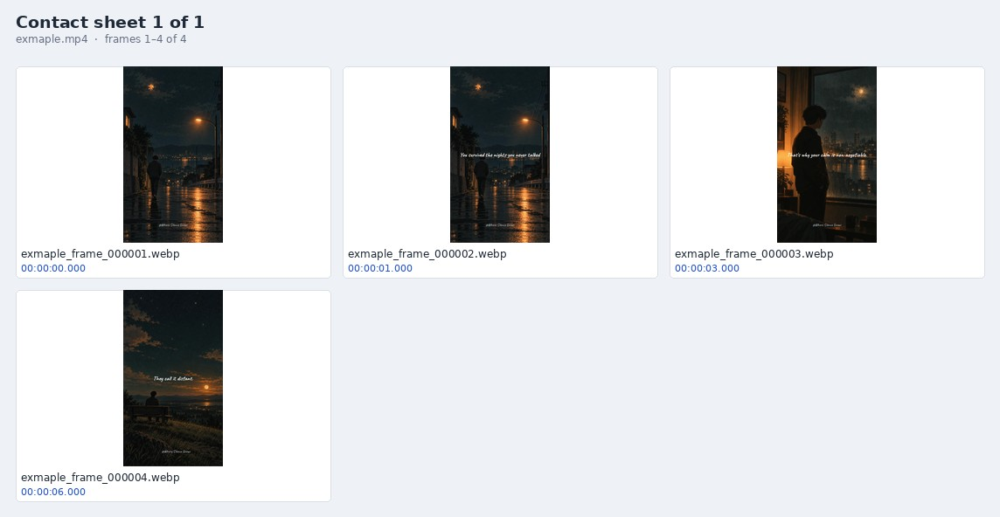
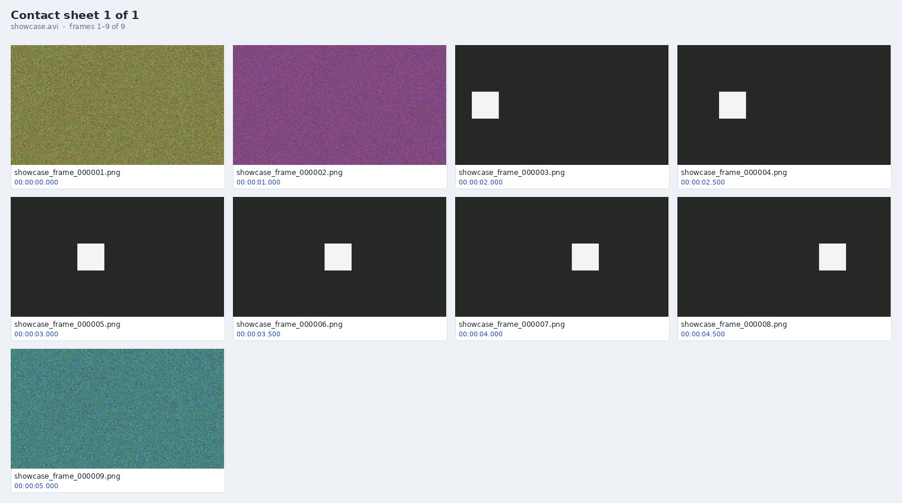

# Video Frame Extractor

A local desktop application that turns a video into a small set of distinct, representative
still images. Everything runs locally: no uploads, accounts, cloud APIs or paid services.



*The contact sheet from the real sample run documented below: ten candidates were examined
and four images were retained. The worked example walks through every decision — including
the fourth quote card the filter treated as redundant.*

**Contents**

- [Why this exists](#why-this-exists)
- [Quick start](#quick-start)
- [The complete process](#the-complete-process)
- [What happens inside](#what-happens-inside)
- [Worked example: the sample video](#worked-example-the-sample-video)
- [How the similarity filter works](#how-the-similarity-filter-works)
- [Settings reference](#settings-reference)
- [Output reference](#output-reference)
- [Python API](#python-api)
- [Testing](#testing)
- [Troubleshooting](#troubleshooting)
- [Limitations](#limitations)
- [Project layout](#project-layout)
- [License](#license)

## Why this exists

Extracting one frame per second is easy. The hard part is that most of those frames are
redundant: a static scene produces dozens of near-identical images, while a one-second
gesture can produce only two or three. The useful output is not "every frame" but one clear
image per visual group, plus the moments where the picture actually changes.

This application treats extraction as a selection problem:

- **Candidates** are chosen by your extraction method.
- **Perceptual comparison** decides whether a candidate adds new visual information.
- **One representative** is kept per visual group, upgraded when a later frame is clearly
  sharper.
- **Hard cuts and meaningful motion** force a new group even when the overall image is
  similar.

The guiding rule: keep one representative when several frames are redundant, but never
delete meaningful visual information merely to reduce the count.

## Quick start

### Windows 10 / 11 (PowerShell)

```powershell
cd C:\Users\YourName\video-frame-extractor
py -3.11 -m venv .venv
.\.venv\Scripts\Activate.ps1
python -m pip install --upgrade pip
pip install -r requirements.txt
python main.py
```

If PowerShell blocks activation:

```powershell
Set-ExecutionPolicy -Scope Process -ExecutionPolicy Bypass
.\.venv\Scripts\Activate.ps1
```

Or skip activation entirely:

```powershell
.\.venv\Scripts\python.exe -m pip install -r requirements.txt
.\.venv\Scripts\python.exe main.py
```

Install Python from <https://www.python.org/downloads/windows/> and leave **Add python.exe to
PATH** and the optional **Tcl/Tk** component enabled. FFmpeg is optional but recommended for
reliable metadata (`winget install --id Gyan.FFmpeg -e`, then open a new terminal).

### macOS

```bash
cd ~/video-frame-extractor
python3 -m venv .venv
source .venv/bin/activate
python -m pip install --upgrade pip
pip install -r requirements.txt
python main.py
```

FFmpeg is optional: `brew install ffmpeg`.

### Linux (Ubuntu / Debian)

```bash
sudo apt update
sudo apt install python3-tk python3-venv libgl1 libglib2.0-0 ffmpeg
cd ~/video-frame-extractor
python3 -m venv .venv
source .venv/bin/activate
python -m pip install --upgrade pip
pip install -r requirements.txt
python main.py
```

On Fedora: `sudo dnf install python3-tkinter ffmpeg`.

If `python3 -m venv` fails because `ensurepip` or Tkinter is missing, use
[`uv`](https://docs.astral.sh/uv/) instead:

```bash
uv venv --clear --python 3.12 .venv
source .venv/bin/activate
uv pip install -r requirements.txt
python main.py
```

### Dependencies

`requirements.txt`:

```text
opencv-python>=4.8
Pillow>=10.0
numpy>=1.24
ImageHash>=4.3
```

`ImageHash` pulls in SciPy and PyWavelets automatically. Python 3.11 or newer is expected.

## The complete process

The window has five sections: Video, Extraction, Similarity filtering, Output, and Review &
metadata. The complete process, in the order you meet it:

### Pick the video

Click **Browse Video…** and pick a file. Supported extensions: MP4, MOV, AVI, MKV, WebM,
WMV, MPEG and MPG.

The app reads the video in a background thread while the window stays responsive. It shows
duration, resolution, frame rate, total frames, selected range and an estimate of how many
candidate frames the chosen method will examine. FFprobe is used when installed; otherwise
the app falls back to OpenCV. The **Metadata source** field tells you which one answered.

**What happens internally:** `probe_video()` runs FFprobe with a 20-second timeout when the
executable is on `PATH`, then probes with OpenCV as a cross-check and fallback. Missing
values are filled from the other source. An unreadable file raises a user-facing error
before any output folder is created.

When you pick a video, the output folder changes to `<video folder>/ExtractedFrames` unless
you have already chosen a different folder. The first candidate count is only an estimate:
similarity filtering decides how many images are actually kept.

### Choose the extraction method

| Method | What it examines | Candidate rule |
|---|---|---|
| **Every frame** | Every decodable frame in the range | All frames |
| **Fixed time interval** | One sample every *N* seconds (0.25 = four per second) | First frame at or after each target time |
| **Fixed frame interval** | Every *N*th decoded frame, counted from the start of the range | Frame 0, N, 2N, … in range |
| **Automatic (scene-aware)** | Every frame | All frames; filtering is forced on |

**Fixed time interval** is the default and the best starting point. **Every frame** is what
you want when you need a complete decode, but it is also the slowest and produces the most
files. **Fixed frame interval** is useful when you think in source frames rather than
seconds. **Automatic** is the hands-off mode: it looks at everything and keeps
representatives at cuts and meaningful motion.

### Set the time range

**Start time** defaults to `0`; **End time** can be left blank to use the rest of the video.
Both accept seconds (`12.5`) or `HH:MM:SS` (`00:00:12.5`). The end is clamped to the video
duration when necessary. A start at or after the end of the video is rejected.

### Decide how strict the filter is

Leave **Keep only representative frames** enabled for the main benefit. The threshold is a
percentage:

- **90 % (default)** removes obvious redundancy while preserving normal motion and cuts.
- **95–98 %** keeps more frames; useful for subtle action or important detail.
- **50–85 %** removes more aggressively; useful for slideshows or highly repetitive footage.
- **Uncheck** the option to write every selected candidate.

**Preserve more frames** adds 5 percentage points to the effective threshold and makes the
motion guard 40 % more sensitive. In the sample run, a 90 % threshold with **Preserve more**
became an effective 95 % threshold and a 2.4 % motion guard.

Scene-aware mode always enables filtering and disables the checkbox.

### Choose the output

Choose where the timestamped job folder will be created, then:

- **Image format:** PNG (lossless), JPEG or WebP.
- **Quality:** 1–100, used by JPEG and WebP; ignored for PNG.
- **Resize:** original, maximum width, maximum height, or a custom box. Aspect ratio is
  preserved and images are never enlarged.
- **Also save original-resolution copies:** available only when resizing is active. Copies
  go to `originals/`.

### Choose the review artifacts

Both outputs are on by default:

- **Contact sheets:** one or more labelled JPEG grids, split by **Max thumbnails per sheet**
  (default 40) with **Columns** (default 4).
- **metadata.json:** the machine-readable record of the job.

### Run the job

**Start Extraction** validates every setting, checks that at least 100 MB is free on the
output volume, creates a unique job folder and opens the video. The GUI shows candidates
examined, images retained, images removed, elapsed time and an ETA.

For videos longer than 30 minutes, or when the estimate exceeds 5,000 candidates, the app
asks for confirmation first.

**Pause**, **Resume** and **Cancel** work between frames. Cancelling keeps the images that
were already written, saves the buffered representative when possible, and — when the report
is enabled — still writes it with `"cancelled": true`.

### Review the result

Open `frames/` or the contact sheet for a quick visual audit, or click **Open Output
Folder** in the completion dialog. Read `metadata.json` to map every output image back to
its original timestamp. If the filter was too aggressive, re-run with a higher threshold or
**Preserve more frames**; if it kept too much, lower the threshold. Use the contact sheet as
the audit trail, not the file count alone.

## What happens inside

```text
Video
  │
  ├─ probe_video()
  │    ├─ FFprobe: duration, resolution, frame rate, frame count, codec
  │    └─ OpenCV fallback and gap filling
  │
  └─ extraction loop (one decoded frame at a time; the whole video is never loaded)
       ├─ method filter ──► is this frame a candidate?
       ├─ analyze_frame() ─► pHash, dHash, 160×90 grayscale, HSV histogram, sharpness
       ├─ group logic
       │    ├─ hard scene cut?          ──► finish the current group, start a new one
       │    ├─ meaningful motion?       ──► finish the current group, start a new one
       │    ├─ similar enough?          ──► drop it, or replace the buffered frame if sharper
       │    └─ otherwise                ──► write the buffered representative, start a new group
       ├─ FrameWriter.save()
       │    ├─ resize with Lanczos (optional)
       │    ├─ write to a .part file
       │    └─ atomic os.replace()
       └─ progress callback ──► queue ──► Tkinter main thread
  │
  ├─ contact sheet generation (reads the saved images)
  └─ metadata.json + extraction.log
```

Memory stays bounded: one representative frame is buffered, plus compact signatures for up
to 256 recent groups. Candidates are never accumulated in memory.

## Worked example: the sample video

This repository includes a short vertical sample at `vdo/exmaple.mp4`. It is a 9.3-second
quote montage with four cards and crossfades. The run below is a real job from this working
copy, not an illustration.

### Settings used

| Setting | Value |
|---|---|
| Video | `vdo/exmaple.mp4` — 720 × 1280, 30 fps, 276 frames, H.264 |
| Method | Fixed time interval |
| Interval | 1.0 second |
| Start / end | 0 / blank |
| Similarity filtering | On |
| Threshold | 90 % |
| Preserve more frames | On — effective threshold 95 %, effective motion guard 2.4 % |
| Image format | WebP, quality 95 |
| Resize | Original resolution |
| Contact sheet | 4 columns; single sheet |
| Metadata | On |

### Result

| Metric | Value |
|---|---|
| Candidates examined | 10 |
| Images retained | 4 |
| Frames removed as redundant | 6 (60 %) |
| Contact sheets | 1 |
| Elapsed | 0.96 s |

The retained images are at **0.0, 1.0, 3.0 and 6.0 seconds**. The contact sheet at the top of
this README is this run.

### Output

```text
frames/exmaple_extracted_20261102_145714/
├── frames/
│   ├── exmaple_frame_000001.webp    00:00:00.000
│   ├── exmaple_frame_000002.webp    00:00:01.000
│   ├── exmaple_frame_000003.webp    00:00:03.000
│   └── exmaple_frame_000004.webp    00:00:06.000
├── contact_sheets/
│   └── exmaple_contact_sheet_001.jpg
├── metadata.json
└── extraction.log
```

No `originals/` folder appears because the images were not resized. `frames/` is generated
output and is ignored by Git; the copy of the contact sheet under `docs/` is what this
README displays.

### The job log

```text
INFO Video: …/vdo/exmaple.mp4 (720 x 1280, 30.000 fps, 9.333016)
INFO Job folder: …/frames/exmaple_extracted_20261102_145714
INFO Mode=time_interval start=0.000 end=None interval=1.000 frame_interval=30
     filtering=True threshold=95.0 format=webp resize=original
INFO Finished: candidates=10 retained=4 removed=6 cancelled=False elapsed=1.0s
```

Paths are shortened, the `Mode` line is wrapped, and elapsed time is rounded to one decimal
in the log (the report keeps 0.96 s). Every job writes a log like this next to its output.

### Why these four frames

The source has four quote cards. Similarity is measured against the buffered representative
of the current group (not merely the previous frame), while hard cuts are detected between
consecutive analysed frames.

| Time | Decision | Evidence |
|---:|---|---|
| 0.0 s | Kept | First candidate; starts the first group |
| 1.0 s | Kept | 96.3 % similar to 0.0 s, but 2.8 % of pixels changed — above the 2.4 % motion guard, so the appearing quote is preserved |
| 2.0 s | Removed | Identical to 1.0 s (100 %, 0.0 % changed) |
| 3.0 s | Kept | Hard cut: 50 % of pixels changed vs 2.0 s — above the 32 % scene-cut threshold (similarity score 40.5 %) |
| 4.0 s | Removed | Identical to 3.0 s |
| 5.0 s | Removed | 99.4 % similar to 3.0 s, 0.0 % changed |
| 6.0 s | Kept | Hard cut: 44 % of pixels changed vs 5.0 s — above the 32 % scene-cut threshold (similarity score 50.3 %) |
| 7.0 s | Removed | Identical to 6.0 s |
| 8.0 s | Removed | 98.5 % similar to 6.0 s, 0.5 % changed — the fourth quote differs mainly by its text |
| 9.0 s | Removed | 95.6 % similar to 6.0 s, 1.4 % changed |

The run is a good demonstration of both sides of the design:

- **It preserved a subtle but meaningful change.** The first card's quote fades in between
  0 and 1 seconds. Similarity was still 96.3 %, above the 95 % threshold, but the motion
  guard saw 2.8 % of pixels change and kept the frame.
- **It missed a semantic change.** The fourth card differs from the third mostly by its
  text. Perceptual hashes and SSIM barely notice a small text block, and only 0.5 % of
  pixels changed, so the card was treated as redundant.

To keep the fourth card, set the threshold to **99 %** (above the measured 98.5 %) or
disable similarity filtering. Raising the threshold is the targeted fix, though it may also
keep more than one frame of that card; disabling filtering is exhaustive. This is the
intended trade-off, not a bug: the filter compares pictures, not meaning.

### Reproduce it

In the GUI, use the settings table above. From Python:

```python
from pathlib import Path

from vfe.config import ContactSheetSettings, ExtractionSettings, SimilaritySettings
from vfe.extractor import run_extraction

result = run_extraction(
    ExtractionSettings(
        video_path=Path("vdo/exmaple.mp4"),
        output_root=Path("frames"),
        mode="time_interval",
        interval_seconds=1.0,
        image_format="webp",
        quality=95,
        similarity=SimilaritySettings(
            enabled=True,
            threshold=90.0,
            preserve_more=True,
        ),
        contact_sheet=ContactSheetSettings(
            enabled=True,
            columns=4,
            max_thumbnails=40,
        ),
    )
)

print(result.retained_frames, "images in", result.job_dir)
```

### The report

`metadata.json` is the authoritative record of what was saved. This is an abridged copy of
the sample run's report:

```json
{
  "application": "Video Frame Extractor",
  "version": "1.0.0",
  "extraction_date": "2026-11-02T14:57:15+00:00",
  "cancelled": false,
  "video": {
    "filename": "exmaple.mp4",
    "path": "…/vdo/exmaple.mp4",
    "duration_seconds": 9.333,
    "duration": "00:00:09.333",
    "width": 720,
    "height": 1280,
    "frame_rate": 30.0,
    "total_frames": 276,
    "total_frames_estimated": false,
    "codec": "h264",
    "metadata_source": "FFprobe"
  },
  "extraction": {
    "method": "time_interval",
    "method_label": "Fixed time interval",
    "start_seconds": 0.0,
    "start": "00:00:00.000",
    "end_seconds": null,
    "end": null,
    "time_interval_seconds": 1.0,
    "frame_interval": null,
    "image_format": "WEBP",
    "quality": 95,
    "resize": {
      "mode": "original",
      "max_width": null,
      "max_height": null,
      "save_original_resolution_copies": false
    },
    "elapsed_seconds": 0.96
  },
  "similarity_filtering": {
    "enabled": true,
    "threshold_percent": 90.0,
    "effective_threshold_percent": 95.0,
    "preserve_more": true,
    "motion_sensitivity": 0.04,
    "effective_motion_sensitivity": 0.024
  },
  "results": {
    "candidate_frames": 10,
    "retained_images": 4,
    "removed_frames": 6,
    "removed_percent": 60.0,
    "contact_sheets": ["contact_sheets/exmaple_contact_sheet_001.jpg"]
  },
  "frames": [
    {
      "frame_number": 1,
      "filename": "frames/exmaple_frame_000001.webp",
      "timestamp_seconds": 0.0,
      "timestamp": "00:00:00.000"
    }
  ],
  "errors": [],
  "warnings": []
}
```

The `frames` array has one entry per retained image; only the first is shown here. If
original-resolution copies exist, each entry also has an `original_filename` field. The
`similarity_filtering.method` string is omitted from this excerpt for space.

## How the similarity filter works

Each candidate is reduced to a compact signature:

- **64-bit pHash** and **64-bit dHash** for near-duplicate recognition.
- **SSIM** on a 160 × 90 blurred grayscale image.
- **HSV hue–saturation histogram** (24 × 24 bins) to catch colour changes that grayscale
  SSIM would miss.
- **Laplacian variance** as a sharpness score.

The combined score is:

```text
similarity = 0.45 × SSIM
           + 0.30 × (1 − (0.6 × pHash distance + 0.4 × dHash distance) / 64)
           + 0.25 × colour-histogram correlation
```

Each candidate is compared with the **buffered representative of the current visual group**,
not merely the previous frame. This is what prevents slow drift from collapsing an entire
scene into one image.

A candidate is redundant only when all three conditions hold:

1. Its similarity score meets the effective threshold.
2. The motion guard finds less than the effective motion fraction: pixels whose grayscale
   difference exceeds 12, as a fraction of the 160 × 90 analysis image. The default is 4 %;
   **Preserve more** reduces it to 2.4 %.
3. No hard scene cut was detected.

A hard cut is a changed-pixel fraction of at least 32 % between consecutive analysed frames.
It always finishes the current group and starts a new one.

When a new group begins, a stricter repeat check compares the new candidate with up to 256
recently retained signatures. If a recent image is near-identical (score at least
`max(0.96, threshold + 1 point)`, with tight hash-distance pre-filters and no motion), the
new group is marked as a **shadow**: it is not written. This suppresses short repeated shots,
such as a title card that appears again later.

Inside a redundant group, a frame that is more than 25 % sharper (Laplacian variance) than
the buffered representative replaces it, so the clearest useful image is written. Exact
duplicates never replace anything.

Safeguards:

- The first valid candidate is always kept.
- Hard cuts force a new group.
- Significant subject motion forces a new group.
- Filtering can be disabled; every selected candidate is then written.
- Scene-aware mode always filters.
- Raising the threshold keeps more; lowering it removes more.
- A failed frame analysis stops the run and is recorded in `errors`.



*The synthetic validation clip used by the test suite: two static shots, a hard cut, six
representatives of a slowly moving white box, and a final shot. The repeated first shot at the
end is suppressed as a duplicate.*

## Settings reference

### Extraction

| Setting | Default | Notes |
|---|---|---|
| Method | Fixed time interval | Every frame, time interval, frame interval, scene-aware |
| Time interval | 1.0 s | Must be greater than 0 and at most 24 hours |
| Frame interval | 30 | Every Nth frame in the selected range |
| Start time | 0 | Seconds or `HH:MM:SS`; cannot be negative |
| End time | blank | Blank means end of video; must be later than start |

### Similarity filtering

| Setting | Default | Notes |
|---|---|---|
| Enabled | on | Can be disabled except in scene-aware mode |
| Threshold | 90 % | 50–100 in the GUI, 0–100 through the API; higher keeps more |
| Preserve more | off | +5 points and a 40 % more sensitive motion guard |
| Motion sensitivity | 0.04 | API/config only; fraction of changed pixels that forces a new group |

### Output

| Setting | Default | Notes |
|---|---|---|
| Output folder | `~/VideoFrames`, then `<video folder>/ExtractedFrames` | One timestamped job folder per run |
| Image format | PNG | PNG, JPEG, WebP |
| Quality | 95 | JPEG/WebP only; 1–100 |
| Resize | Original | Max width, max height, or custom box; never enlarges |
| Save originals | off | Only when resizing is active |

### Review

| Setting | Default | Notes |
|---|---|---|
| Contact sheets | on | JPEG grids with filenames and timestamps |
| Columns | 4 | 1–12 |
| Max thumbnails per sheet | 40 | 1–1000; larger jobs split into several sheets |
| metadata.json | on | Settings, counts, timestamps, errors, warnings |

## Output reference

```text
<output folder>/
└── <video stem>_extracted_<YYYYMMDD_HHMMSS>/
    ├── frames/                 # retained images, in video order
    ├── originals/              # only when resized and "save originals" is on
    ├── contact_sheets/         # one or more JPEG sheets
    ├── metadata.json
    └── extraction.log
```

- **`frames/`** — zero-padded output sequence (`..._frame_000001.png`), not original frame
  numbers. The timestamp in `metadata.json` maps each file back to the video.
- **`originals/`** — full-resolution copies with the same filenames, written only when the
  output was resized and the option was enabled. A failure to write a copy is a warning, not
  a failed job.
- **`contact_sheets/`** — each sheet is titled `Contact sheet N of M`, shows the video name
  and frame range, and captions every thumbnail with its output filename and original
  timestamp. Portrait images fit inside a 16:9 cell. Sheets use the original-resolution copy
  when one exists.
- **`metadata.json`** — written atomically and even when the job is cancelled.
- **`extraction.log`** — the job's diagnostic log. Include it when reporting a problem.

If the job folder already exists in the same second, a numeric suffix is added (`_2`, `_3`,
…). Nothing is overwritten.

If no frames could be decoded in the selected range, the report records that as an error.
When `write_metadata` is disabled, the folder still contains the frames and the log (plus
contact sheets when enabled); only the JSON report is missing.

## Python API

The GUI is a thin layer over `run_extraction()`. The core is usable directly, which is handy
for batches and reproducible jobs. It raises `ValidationError` or `VideoError` when the job
cannot be started; errors during processing are captured in the result, and cancellation is
reported as `result.cancelled`.

```python
from pathlib import Path

from vfe.config import ExtractionSettings, SimilaritySettings
from vfe.extractor import run_extraction

result = run_extraction(
    ExtractionSettings(
        video_path=Path("input.mp4"),
        output_root=Path("output"),
        mode="scene",
        similarity=SimilaritySettings(enabled=True, threshold=90.0),
    )
)

print(result.job_dir)
print(result.candidate_frames, result.retained_frames, result.removed_frames)
print(result.metadata_path, result.errors, result.cancelled)
```

Mode strings are `every_frame`, `time_interval`, `frame_interval` and `scene`;
`image_format` accepts `png`, `jpeg` or `webp`.

`ExtractionResult` also exposes `records` (one `FrameRecord` per saved image),
`contact_sheets`, `warnings`, `video_info` and `elapsed_seconds`.

For progress and cancellation, pass a callback and an `ExtractionControl`:

```python
from vfe.extractor import ExtractionControl

# settings from the example above
control = ExtractionControl()

def on_progress(progress):
    print(f"{progress.candidates} candidates, {progress.retained} retained")
    if progress.candidates >= 500:
        control.cancel()

result = run_extraction(settings, control=control, progress_callback=on_progress)
```

`ExtractionControl` also provides `pause()` and `resume()`.

## Testing

```bash
python -m unittest discover -s tests -v
```

The suite builds a synthetic 7-second video in a temporary folder and covers:

- FFprobe/OpenCV metadata probing;
- every-frame extraction with filtering off (all 210 frames written);
- filtering preserves scene changes and motion but suppresses a repeated shot;
- **Preserve more** never retains fewer frames;
- fixed-time extraction with a selected range;
- fixed-frame extraction;
- scene-aware mode forcing filtering;
- resizing with original-resolution copies;
- cancellation keeping partial output and writing metadata;
- unique job folders when two runs collide;
- unreadable and missing videos;
- identical, different and moving-frame similarity scores;
- timestamp rounding and time parsing.

**Verified here:** Python 3.14 on Linux, 17 tests passed in about 18 seconds, with FFprobe
installed. The suite exercises the extraction core, not the Tkinter interface; the interface
is covered by the manual checks below.

### Manual smoke checks

| # | Case | Expected |
|---|---|---|
| 1 | 5–10 s MP4, every frame, filtering off | One image per decoded frame |
| 2 | 30+ minute 1080p file, 10 s interval | GUI stays responsive; memory stays low; confirmation appears |
| 3 | Variable-frame-rate phone recording | Timestamps stay increasing; range extraction works |
| 4 | Static 10 s shot, filtering on | First frame kept; duplicates removed |
| 5 | Hard cut between two rooms | A representative at the cut and for both rooms |
| 6 | Slow walk across a static background | Multiple images across the walk, not one |
| 7 | Cancellation mid-job | Saved images remain; no `.part` files; report says cancelled |
| 8 | Start twice into the same folder | Two unique job folders; nothing overwritten |
| 9 | Max width 1280 | Width ≤ 1280, aspect ratio preserved, no upscaling |
| 10 | PNG, JPEG, WebP | Valid images; quality affects JPEG/WebP only |

## Troubleshooting

| Problem | Fix |
|---|---|
| `No module named 'cv2'` | Activate the virtual environment, then `pip install -r requirements.txt` |
| `No module named 'tkinter'` | Windows/macOS: reinstall Python with Tcl/Tk. Debian/Ubuntu: `sudo apt install python3-tk`. Fedora: `sudo dnf install python3-tkinter` |
| `.venv/bin/activate: No such file or directory` | The environment was never created. Create it again from the installation steps |
| `.venv` exists but has no pip or Tkinter | The system Python lacked venv/Tk support. Rebuild with `uv venv --clear --python 3.12 .venv` |
| Video cannot be opened | Check the file is complete and not still copying; install FFmpeg; try another file |
| FFprobe not found | Optional. Install FFmpeg and reopen the app; metadata falls back to OpenCV |
| Very slow extraction | Avoid **Every frame** on long 4K videos; use a longer interval, resize during extraction, or enable filtering |
| Output is huge | Use JPEG/WebP, enable resizing, or raise the interval |
| Too many similar images | Lower the threshold (for example 85 %) and do not use **Preserve more** |
| Too few images | Raise the threshold to 95 % or more, enable **Preserve more**, or shorten the interval |
| A subtle change was missed | Raise the threshold, lower the interval, or disable filtering for critical material |
| GUI freezes briefly | The metadata probe is brief; extraction runs in a background thread. Pause and cancel take effect between frames |
| Cannot open output folder | Open the path shown in the completion dialog manually; the OS file manager may be unavailable in remote sessions |
| `Only N MB of free disk space` | Free space or choose another output folder; the app requires at least 100 MB |

## Limitations

- **Perceptual similarity is not semantic understanding.** The app cannot know that a person
  smiled or that an object matters. A small visual change can be classified as redundant —
  the fourth quote card in the sample run is a concrete example. Use **Preserve more**, raise
  the threshold, or disable filtering for critical material.
- **Thresholds are content-dependent.** The 90 % default works for ordinary footage, but
  animation, static slideshows and heavy grain may need adjustment.
- **Timestamps are approximate.** They come from OpenCV's presentation-time reporting and
  may be a fraction of a frame off, occasionally more on unusual variable-frame-rate files.
  FFprobe is used for reliable metadata when installed. `metadata.json` is the source of
  truth for what was saved, not SMPTE-exact mastering data.
- **Rotation metadata** is applied when the OpenCV/FFmpeg build honours it. Check a test
  image for portrait phone footage.
- **Scene-aware mode is visual grouping, not an editor's shot list.** It combines hard-cut
  detection with the motion-aware similarity filter.
- Audio is ignored. Contact sheets are JPEG. There is no GPU acceleration.
- Codec support depends on the OpenCV/FFmpeg build installed with `opencv-python`.
- The test suite does not exercise the Tkinter interface.

## Project layout

```text
video-frame-extractor/
├── main.py                     # Entry point; friendly Tkinter error message
├── requirements.txt
├── README.md
├── docs/
│   ├── contact_sheet_example.jpg        # Synthetic validation clip
│   └── example_run_contact_sheet.jpg    # The real sample run above
├── vdo/
│   └── exmaple.mp4             # The sample video used by the worked example
├── frames/                     # Generated example output (ignored by Git)
├── vfe/
│   ├── __init__.py             # Version
│   ├── errors.py               # User-facing exception types
│   ├── config.py               # Settings dataclasses, constants, validation
│   ├── utils.py                # Time parsing, formatting, filename safety
│   ├── probe.py                # FFprobe metadata + OpenCV fallback
│   ├── similarity.py           # Signatures, similarity, motion and cut detection
│   ├── images.py               # Resizing, atomic image writes, filenames
│   ├── extractor.py            # Extraction loop, grouping, pause/cancel, progress
│   ├── contactsheet.py         # Multi-sheet labelled thumbnail grids
│   ├── report.py               # metadata.json generation
│   └── gui.py                  # Tkinter desktop interface
└── tests/
    └── test_extraction.py      # 17 automated tests
```

## License

No license file is included in this repository. Add one before distributing the project.
